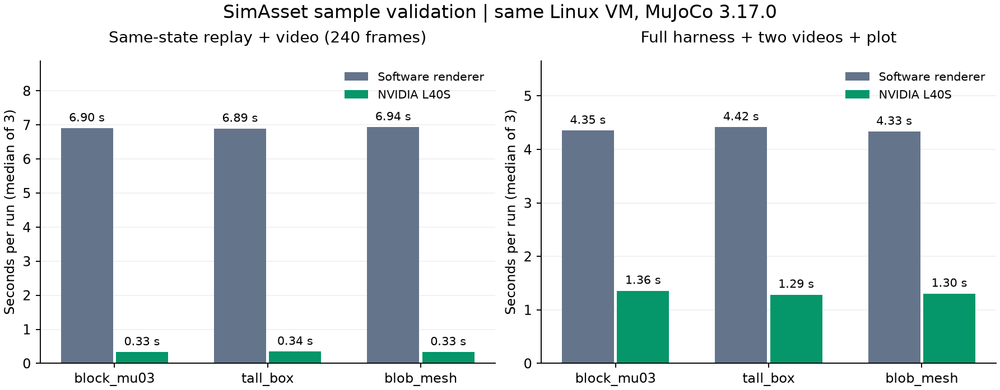
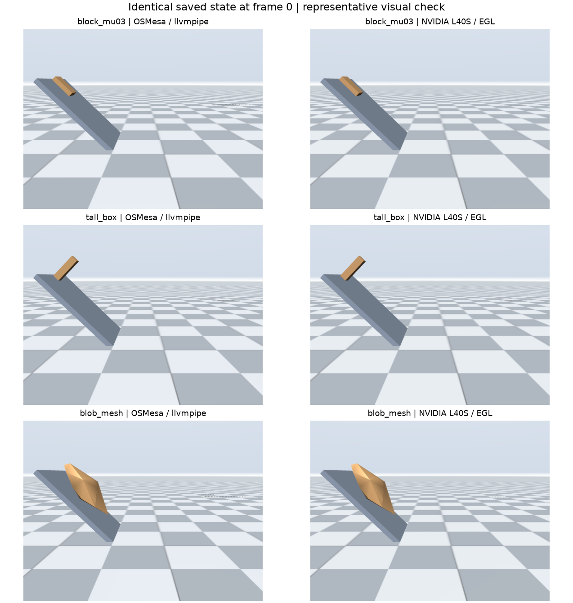

# Nebius GPU 검증 결과

대표 샘플 3개에서 물리 결과를 유지하면서 NVIDIA GPU로 영상을 생성할 수 있음을 확인했습니다. **같은 Linux VM의 소프트웨어 렌더링과 비교하면 영상 저장은 20.1~20.9배, 원래 검사·영상 2종·그래프 저장 전체는 3.20~3.44배 빨라졌습니다.**

후속으로 영상 54개 전체 프레임과 Mac/Linux 수치를 대조했습니다. 환경 혼용 조건, 30fps에서 순간 접촉을 놓치는 사례, 기록 시점 보완 사항은 [실행환경별 평가 일관성](실행환경별_평가일관성.md)에 정리했습니다.

현재 작은 샘플은 Mac M1에서도 전체 작업이 약 1.2초로 끝납니다. 따라서 지금부터 모든 검사를 클라우드로 옮길 필요는 없습니다. 로컬 실행을 기본으로 두고, 실제 에셋의 영상 생성량이 늘어날 때 GPU를 짧게 켜서 비교하는 방향이 적절합니다.

## 처리시간

아래는 각각 3회 측정한 중앙값이며 단위는 초입니다. 소프트웨어와 GPU 경로는 **동일한 L40S VM**에서 비교했습니다. 이 배수를 Mac M1 대비 속도 향상으로 해석하지 않습니다.

| 샘플 | 동일 상태 영상: SW | 동일 상태 영상: GPU | 속도 향상 | 전체 검사: SW | 전체 검사: GPU | 속도 향상 |
| --- | ---: | ---: | ---: | ---: | ---: | ---: |
| block_mu03 | 6.903 | 0.330 | 20.9배 | 4.352 | 1.358 | 3.20배 |
| tall_box | 6.891 | 0.343 | 20.1배 | 4.417 | 1.285 | 3.44배 |
| blob_mesh | 6.935 | 0.332 | 20.9배 | 4.334 | 1.304 | 3.32배 |

‘동일 상태 영상’은 8초 동안 저장한 240개 상태를 640×480 영상으로 만듭니다. 물리 step을 다시 진행하지 않으며 MuJoCo 렌더러 생성 시간은 제외합니다. ‘전체 검사’는 원래 하네스의 조기 종료 조건과 CPU 물리, visual/collision 영상, 그래프, 파일 저장을 포함합니다. 두 실험은 출력 분량이 달라 시간 자체를 서로 비교하지 않습니다. 렌더러 초기화·파일 처리·인코더 대기 등으로 전체 작업의 개선 폭이 줄어듭니다. 모든 반복의 원시 시간도 보존했습니다.

## 물리 결과와 저장 품질

Mac과 Linux의 CPU 물리 궤적은 검증된 같은 초기 상태를 넣었을 때 세 샘플 모두 진단 허용오차 안에서 일치했습니다. 위치 성분 기준은 `1e-6 m`, quaternion 성분 기준은 `1e-6`입니다. 에셋의 품질 통과 기준으로 사용한 값은 아닙니다.

| 샘플 | 위치 성분 최대 차이 | quaternion 성분 최대 차이 | Linux 반복 상태 |
| --- | ---: | ---: | --- |
| block_mu03 | 9.003e-13 m | 7.374e-12 | 3/3회 경고 없음 |
| tall_box | 4.778e-12 m | 4.187e-11 | 3/3회 경고 없음 |
| blob_mesh | 6.122e-12 m | 2.353e-11 | 3/3회 경고 없음 |

- 소프트웨어/GPU 전체 검사 9쌍의 실행 상태·요약 측정값이 일치했습니다. 각 쌍의 시계열 CSV는 SHA-256까지 동일합니다.
- 영상 54개를 끝까지 디코딩해 오류가 없음을 확인했습니다. 길이는 1.7~8초이며, PNG 30개도 보존했습니다.
- 대표 이미지에서 물체와 빗면 구성을 확인했습니다. 픽셀 단위로 동일하지는 않습니다. 샘플당 2프레임의 RGB RMSE는 0~255 범위에서 약 1.09~2.05이며, 픽셀 차이를 물리 실패로 판정하지 않습니다. 전체 영상의 모든 장면에 대한 사람의 품질 판정을 대신하는 검사는 아닙니다.
- 최종 결과 압축파일은 3,809,407바이트이며 서버와 다운로드 파일의 SHA-256이 일치합니다.

## 이번에 발견하고 보완한 부분

같은 seed와 설정으로 사전 안정화해도 Mac과 Linux의 초기 자세가 완전히 같은 비트로 나오지는 않았습니다. 첫 샘플의 초기 상태 최대 차이 `2.10e-11` 때문에 기존의 엄격한 초기 상태 확인이 실행을 중단했습니다.

비교 허용오차를 완화하지 않고 `--initial-from`을 추가했습니다. 기준 파일의 에셋·소스·설정·MuJoCo 버전·해시·상태 크기·유한성을 확인한 뒤 같은 초기 상태를 사용합니다. 호스트에서 따로 계산한 초기 상태와 차이도 보존합니다. `cloud_benchmark.py --baseline`은 이 기능을 자동으로 사용합니다. 기준 파일과 공유 하네스 원문은 수정하지 않았습니다.

보완 후 세 샘플의 E1·E2·E3 실행을 모두 완료했습니다. 전체 자동 검사도 **39개 통과**했습니다. 기존 테스트 클라이언트의 deprecation 경고 1건은 남습니다. 이 결과는 같은 초기 상태 이후의 궤적 재현성이며, 사전 안정화 과정 자체의 완전한 동일성을 뜻하지 않습니다.

## 비용과 정리

콘솔에서 확인한 L40S 구성은 1 GPU·8 vCPU·32 GiB RAM·64 GiB SSD이며 시간당 약 1.57달러였습니다. 처음 시도한 RTX PRO 6000은 시작 과정에서 자원 부족으로 최종 실패해 L40S로 전환했습니다. 초기 시도의 CLI 비동기 응답 처리와 시작 대기 보호도 보완했습니다. L40S에서는 자동 종료 예약을 명시적으로 확인한 뒤 실행했습니다.

이번에 만든 두 VM과 관리 디스크는 모두 삭제했습니다. L40S의 동적 공인 IP도 해제됐으며 임시 SSH 개인키와 개인키가 포함된 생성 설정도 제거했습니다. 기존 Devlab·네트워크·보안 그룹·가격 정책은 유지했습니다.

2026-11-18에 받은 사용량 CSV에서 **두 시험 VM과 L40S 디스크의 청구 기준 금액은 0.219770132달러, 약 0.22달러**로 확인했습니다. RTX 시도 컴퓨트 0.027347222달러, L40S 컴퓨트 0.190969333달러, L40S 디스크 0.001453577달러입니다. 실제 자원 ID로 추린 금액이며 기존 디스크와 다른 작업 비용은 제외했습니다. 공급자의 `BilledCost`는 할인 반영 후 청구의 기초가 되는 값입니다. [사용량 CSV 필드 정의](https://docs.nebius.com/signup-billing/usage/focus-fields)

초기 **약 0.80달러**는 생성부터 삭제까지 대기·중지 시간도 모두 포함한 보수적 추정이었습니다. 실패한 RTX 시도도 사용량에는 55초가 기록되어 무료로 처리되지 않았습니다. 계정 잔액 차이를 실험 비용으로 사용하지 않습니다.

아직 남은 비용 확인

RTX 시도와 같은 프로젝트·생존 구간의 64 GiB 디스크에 0.001394812달러가 기록되어 있습니다. 초기 제어기가 이 디스크 ID를 보존하지 않아 VM과의 직접 연결은 미확인입니다. 해당 디스크가 맞으면 합계는 0.221164944달러입니다. 두 경우 모두 센트 단위로 약 0.22달러지만, 이 추론을 확정된 연결로 표시하지 않습니다.

이번 파일은 11월 진행 중 사용량 보고서입니다. 월말 세금·조정까지 마감된 최종 청구서는 아직 확인하지 않았습니다. 원본 내보내기와 자원별 대조 기록은 개인 검증 폴더에 보존했으며, 계정 전체 청구 내역은 팀 자료에 포함하지 않았습니다.

## 이번 결과를 적용할 범위

이번 검증은 `block_mu03`, `tall_box`, `blob_mesh`라는 작은 샘플 3개의 빗면 검사입니다. 50개 실제 에셋과 나머지 검사, 여러 작업의 병렬 처리, MJX/GPU 물리 계산, 학습 성능은 검증하지 않았습니다. 실제 GPU 사용은 OpenGL 렌더러 `NVIDIA L40S/PCIe/SSE2`로 확인했으며 소프트웨어 경로는 `llvmpipe`였습니다. CPU 물리를 GPU로 바꾼 실험은 아닙니다.

GPU는 1초 간격 133개 관측에서 사용률 최대 6%, VRAM 최대 253 MiB였습니다. 순간 최대값을 보장하는 측정은 아니지만 이번 샘플이 48GB급 GPU 메모리를 요구하지 않았다는 근거는 됩니다. 다음에는 실제 복잡한 에셋 몇 개를 같은 방법으로 측정한 뒤 팀의 실행환경을 결정하면 됩니다. Azure 할당량·GitHub 권한 문제는 이 Nebius 검증과 별개로 남아 있습니다.

재현 조건과 보존 파일

- 검증일: 2026-11-18 KST. 최종 벤치마크 실행은 133.18초입니다.
- 환경: Ubuntu 24.04, Linux x86_64, Python 3.11.15, MuJoCo 3.17.0, NVIDIA 드라이버 580.173.02, L40S입니다.
- 조건: seed 0, 빗면 45°, timestep 0.002초, 고정 물리 8초/4,000 step, 각 3회 반복입니다. 전체 하네스는 원래 조기 종료 조건을 유지합니다.
- 입력 묶음 기준 커밋: `7ac92a110eb890d23f7e580009c0cac944f7e237`입니다. 실제 실행한 두 래퍼 파일의 해시는 아래 JSON에 있으며 현재 로컬 수정본과 일치합니다.
- 입력 묶음 SHA-256: `7c0629d532ea32095c77bfc2eee242f9f557e98b963a3c6524019ac89432fe66`
- 최종 결과 SHA-256: `587e7626af7219a1913c786a7373b7c05d521b9edb73d81c5cd01a3870f3e805`
- [검증 수치와 실행 해시](assets/nebius-20261118/nebius-gpu-verification.json)를 저장소에 보관합니다. 원본 영상·CSV·상태와 서버 로그는 개인 산출물 폴더의 `Nebius_GPU_검증/`에 별도로 보관합니다.
- 첫 초기 상태 차이와 부분 결과는 `초기상태_차이_진단/`에 별도로 보존합니다.
- 렌더링과 시뮬레이션의 역할 분리는 [MuJoCo 공식 설명](https://mujoco.readthedocs.io/en/stable/programming/visualization.html)을 참고할 수 있습니다.

