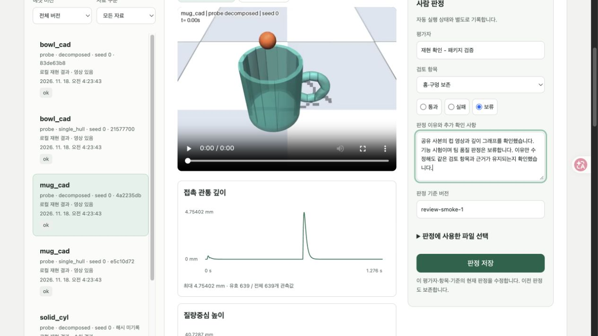
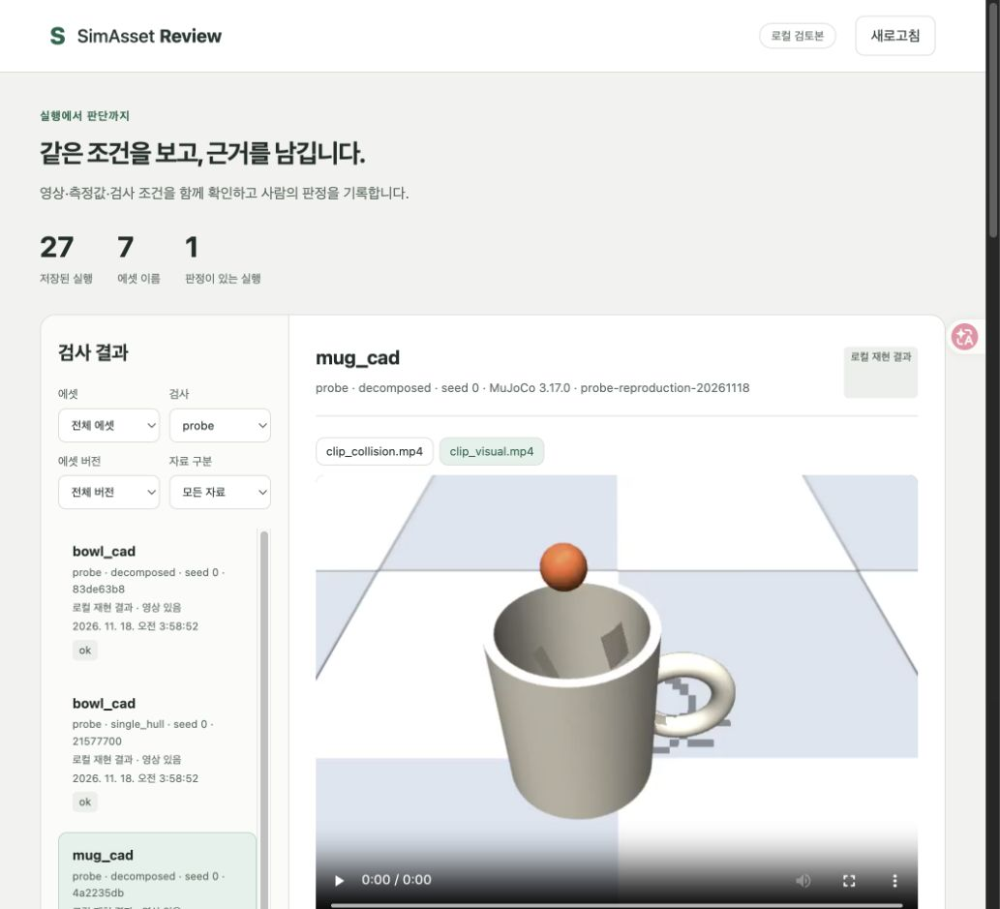
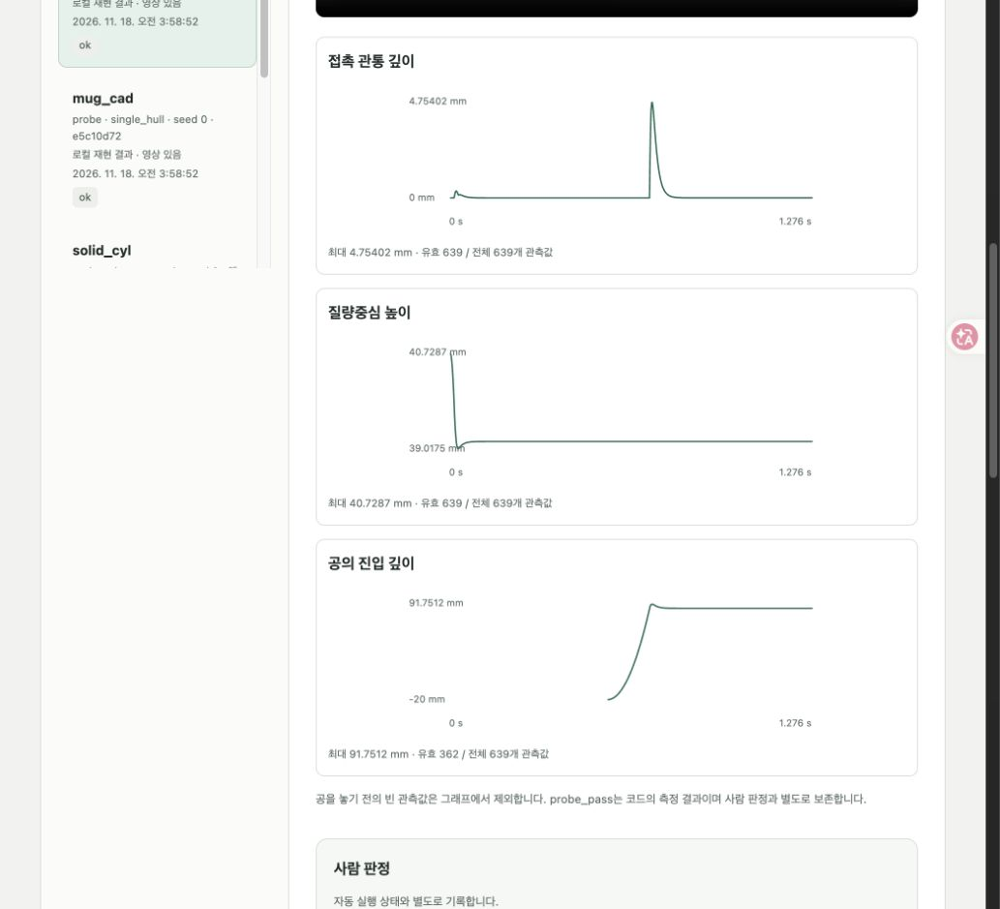

# 결과 검토 시제품 검증 결과

2026년 11월 18일, 공유된 빗면·홈 검사 코드의 샘플을 직접 실행해 파일 가져오기부터 조회·판정 저장까지 연결했습니다. 로컬 시제품과 Nebius L40S의 샘플 실험을 검증했습니다. 팀의 최종 스키마·평가 기준과 Azure GPU 성능을 확정한 결과는 아닙니다.

## 확인한 동작

| 항목 | 확인 결과 |
| --- | --- |
| 자료 수신 | 정상 자료, 같은 묶음 재입력, 같은 ID의 다른 내용, 누락·단위·상태·식별자 오류를 구분합니다. 충돌한 사본도 보존합니다. |
| 원문 보존 | 제공된 원본 파일을 변경하지 않습니다. 내용 해시를 기록한 사본으로 검증하고, 조회 시 파일 변조를 감지합니다. |
| 값 해석 | SI 단위와 원본 값·단위를 함께 보존합니다. NaN·미측정은 NULL과 사유로 유지하며 0으로 바꾸지 않습니다. |
| DB | 전용 PostgreSQL 16.13에 직접 재현한 실행 27개, 측정값 749개가 들어 있습니다. 홈 검사 6개·82개 측정값을 추가했습니다. 기능 시험은 별도 임시 DB에서 수행합니다. |
| 화면 | 내부 브라우저에서 영상 로딩, 시계열 표시, 판정 저장·수정, 새로고침 후 이전 판정 보존을 확인했습니다. 최종 코드에서 에셋 필터·영상 전환·가로 넘침 없음·콘솔 오류 없음을 다시 확인했습니다. |
| 그래프 | block_mu03의 원본 관측값 836개를 표시하고 최대 관통 3.31493 mm를 보존했습니다. DB의 SI 값은 0.00331493 m입니다. 짧은 봉우리를 숨기는 축약은 하지 않습니다. |
| 판정 이력 | UI 시험용 보류 판정 2개 중 현재 판정은 1개입니다. 자동 `ok`를 사람의 통과 판정으로 바꾸지 않았습니다. |
| 많은 실행 | 임시 DB의 1,005개 실행을 1,000개·5개로 조회해 누락·중복이 없음을 검사했습니다. |
| Grafana 연결 | OSS 13.3.1을 실행해 내부 브라우저에서 네 패널·필터·페이지 이동·검토 화면 연결을 확인했습니다. 네 패널의 전체 조회 값이 PostgreSQL 직접 조회와 일치하며, DB 쓰기 권한이 없습니다. |
| 자동 검사 | PostgreSQL·API·입력 검증·판정 이력·환경 비교·종료 보호·Grafana 집계·예상 실행 누락·홈 검사 관측을 포함한 67개 검사를 통과했습니다. 테스트 클라이언트 의존성의 deprecation 경고 1건이 남습니다. |

사람 판정 시험에는 `로컬 UI 검증` 평가자를 사용했습니다. 이 기록은 팀 평가나 에셋 품질 검증으로 집계하면 안 됩니다.

## 공유 묶음과 판정 수정 검증

코드와 홈 검사 샘플 6건을 압축해 새 가상환경에서 설치하고, 기존 개발 DB와 분리한 빈 DB에서 가져왔습니다. 예상 6건·유효 6건, 실행 6건·측정값 82건을 확인했으며 재입력 6건은 모두 중복으로 처리됐습니다. 이 검사는 같은 컴퓨터의 별도 환경에서 수행했으며 다른 팀원의 실제 재현은 아직 받지 않았습니다.

이 과정에서 판정 저장 후 검토 항목과 기준 버전이 기본값으로 돌아가는 문제를 발견했습니다. 같은 실행의 입력 맥락을 유지하고 이력에 `이 판정 수정`을 추가했습니다. 내부 브라우저에서 `cavity / review-smoke-1`의 이유만 수정해 저장하고, 두 근거 파일과 이전 판정이 보존되는 것을 DB와 대조했습니다. 판정 2건 중 현재 판정은 1건이며 다른 항목의 판정은 생기지 않았습니다.

다른 실행으로 이동했을 때 입력이 섞이지 않고, 원래 실행으로 돌아오면 초안이 유지됩니다. 페이지를 새로고침한 뒤에는 이력에서 평가자·항목·기준·이유·근거를 다시 불러오는 것을 확인했습니다. 초안은 페이지 메모리에만 유지되므로 저장하지 않은 입력의 브라우저 종료·재시작 복구 기능은 포함하지 않습니다. 기존 개발 DB의 27개 실행·749개 측정값·현재 판정 1건은 바뀌지 않았습니다.

검증 중 앱에서 발생한 브라우저 오류는 없었습니다. 별도 브라우저 확장 프로그램의 리스너·스트림 경고는 있어 전체 브라우저 로그가 무경고인 것으로 보고하지 않습니다.

## 홈 검사 연결과 누락 검사

민경님이 Notion에 공유한 `probe_env.zip`의 샘플 3종에 대해 `decomposed`와 `single_hull`을 각각 실행했습니다. 원본 파일 해시가 전후 동일하며, 6건을 입력한 뒤 같은 파일을 재입력하면 모두 `duplicate`였습니다. 두 영상씩 생성된 4건의 영상 8개는 디코딩 오류가 없습니다.

| 샘플 | 조건 | 자동 상태 | `probe_pass` | 최종 깊이 mm |
| --- | --- | --- | ---: | ---: |
| mug_cad | decomposed | ok | 1 | 86.9976 |
| mug_cad | single_hull | ok | 0 | 0.000632098 |
| bowl_cad | decomposed | ok | 1 | 41.288 |
| bowl_cad | single_hull | ok | 0 | 0.00055809 |
| solid_cyl | 두 조건 각각 | not_applicable | 미측정 | 미측정 |

`ok`는 실행이 끝났다는 뜻입니다. `probe_pass=0`인 실행도 그대로 보존되며, 사람의 품질 판정은 자동 생성하지 않았습니다. `solid_cyl`의 비어 있는 원본 해시도 NULL로 보존했습니다.

내부 브라우저에서 두 영상 전환, 조건 표시, 홈 깊이 그래프, 미기록 해시 필터, 적용 불가 안내를 확인했습니다. 컵의 decomposed 실행에서 에셋 시계열은 639개, 공을 놓은 이후 깊이 관측은 362개입니다. 앞의 빈 277개를 깊이 0으로 만들지 않으며 최대 91.7512 mm를 그대로 표시합니다. 새로고침 뒤 조회도 유지됐습니다.

예상 실행 목록과 대조하는 `audit`를 추가했습니다. 요약 CSV가 없는 폴더뿐 아니라 폴더 자체가 없는 실행, 예상 밖의 결과, 단위·ID·시각 불일치를 찾습니다. 첫 실행 전에 중단돼도 예상 6개가 누락으로 남는 것을 자동 검사했습니다. 실제 샘플 배치는 예상 6개와 유효 6개가 일치합니다. 이 수치는 선정 50개의 전체 완료율이 아닙니다.

## Grafana 화면 검증

2026년 11월 18일 홈 검사 추가 전에는 다음 값을 확인했습니다. 당시 조회 API가 반환한 전체 값도 같은 SQL의 DB 결과와 대조했습니다. 홈 검사 추가 후에는 내부 브라우저에서 완료 24회·오류 1회·적용 불가 2회와 사람 판정 1건으로 갱신된 것을 확인했습니다. 아래 667행 비교와 재시작 검증은 추가 전의 기준 기록입니다.

| 패널 | 확인한 값 |
| --- | --- |
| 실행 상태 | 완료 20회와 `missing_inertial` 오류 1회입니다. 측정 항목 수를 실행 횟수로 세지 않습니다. |
| 사람 판정 | 현재 보류 판정 1건입니다. 이전 판정까지 중복 집계하지 않습니다. |
| 에셋별 실행 범위 | `blob_mesh` 6회, `block_mu03` 8회, `no_inertial` 1회, `tall_box` 6회입니다. 에셋 이름·내용 해시·검사·출처·상태를 유지해 4행으로 집계합니다. |
| 측정값 | 667행의 값과 NULL이 조회 API에서 DB와 일치합니다. `peak_pen` 필터는 20행을 반환하며, `block_mu03`의 값은 화면에서도 0.00331493 m입니다. |

처음 화면에서 가로 스크롤 뒤에 숨던 실행 수·판정 수를 앞으로 옮기고 한글 열 제목을 적용했습니다. 같은 에셋의 반복 실행은 집계하되 내용 해시와 상태가 다르면 별도 행을 유지합니다. 원본 이름에 `mm`·`pct`가 포함돼도 숫자와 단위는 SI 값이라는 점을 열 제목에 표시했습니다. 전체 기간을 조회하는 SQL에 맞춰 효과가 없는 기간 선택기를 숨겼습니다.

필터 해제 시 전체 667행으로 돌아오며, 필터된 두 페이지에서 20행을 확인했습니다. 상세 표의 1,000행 제한은 제목에 표시했습니다. 표의 숫자는 소수점 8자리로 표시하고 DB 정밀도는 바꾸지 않습니다. 미측정용 NULL·사유 처리의 자동 검사는 통과했지만, 현재 로컬 667행은 모두 `valid=true`이므로 실제 무효 자료의 브라우저 표시는 별도 확인이 필요합니다.

조회 전용 계정의 `default_transaction_read_only=on`, 실행 테이블 INSERT 및 판정 테이블 UPDATE 권한 부재를 확인했습니다. 처음 종료돼 있던 전용 DB를 정상 시작했으며 원본 데이터는 바꾸지 않았습니다. 비어 있는 플러그인·알림 구성 폴더가 없어 발생하던 초기 설정 오류도 보완했습니다. Grafana를 정상 종료 후 다시 실행해 대시보드·데이터소스·조회 값이 유지되는 것을 확인했습니다.

로컬 증거는 `review/evidence/`의 화면 캡처와 `.state/grafana/query-verification.json`에 보관합니다. macOS에서 Grafana 내부 프로세스 통계가 `/proc`을 찾지 못하는 로그는 남아 있습니다. 대시보드 조회와 별개의 런타임 진단이며 전체 로그가 무오류라고 보고하지 않습니다.

## 로컬 측정

Apple M1, macOS 27.0.1, Python 3.11.15, MuJoCo 3.17.0에서 실행했습니다. 원본 하네스의 빗면 45°, timestep 0.002 s, seed 0을 사용하며 샘플별 3회 반복했습니다. 각 값은 중앙값입니다.

| 샘플 | CPU 하네스 전체 s | 영상 2종·plot 포함 전체 s | 그중 CPU step s | 영상 캡처·전달 s | 영상 포함 파일 MB/회 |
| --- | ---: | ---: | ---: | ---: | ---: |
| block_mu03 | 0.1358 | 1.2482 | 0.0106 | 0.8682 | 0.2691 |
| tall_box | 0.1390 | 1.2122 | 0.0108 | 0.8438 | 0.2621 |
| blob_mesh | 0.1372 | 1.2093 | 0.0124 | 0.8314 | 0.2690 |

각 샘플의 CPU 경로와 영상 경로에서 시계열 CSV 해시가 일치했습니다. 영상 경로의 실제 렌더러는 Apple M1입니다. 위의 전체 시간에는 원본 하네스의 조기 종료, 파일 생성 등이 포함됩니다. 단계별 계측은 오버헤드가 있으며, 영상 캡처·전달은 순수 인코더 시간과 다릅니다. 단계별 중앙값의 합이 전체 중앙값과 같을 필요도 없습니다.

고정 8초·4,000 step의 CPU 물리 계산만 측정한 별도 기준은 block_mu03 0.0170 s, tall_box 0.0160 s, blob_mesh 0.0238 s입니다. 각 3회에서 유한한 상태와 물리 경고 0건을 확인했습니다. 초기 상태와 최종 상태도 반복 간 일치했습니다. 위 표의 조기 종료 하네스와 같은 실험으로 합치지 않습니다.

저장된 상태 240개를 그리는 E2는 `mj_step` 없이 실행했습니다. 영상 저장 전체 중앙값 1.4345 s, 상태 복원·`mj_forward`·렌더링 중앙값 1.2977 s였습니다. 전체 시간은 영상 writer 생성과 파일 확정을 포함하지만 MuJoCo 렌더러 생성은 제외합니다.

초기 영상 시험의 6.6586 s는 1회 측정이며 위의 반복 계측과 분리 보관했습니다. 워밍업·초기화·계측 방식이 다른 값을 평균내 성능 개선으로 표현하지 않습니다.

## 이번 결과로 추천하는 방향

현재 작은 샘플에서는 물리 step보다 영상 생성과 파일 처리의 비중이 컸습니다. 결과 조회와 사람 판정은 로컬 시제품으로 검토하고, 실제 에셋의 영상 생성량이 늘어날 때 GPU를 짧게 비교하는 방향이 적절합니다. [Nebius L40S 실측](Nebius_GPU_검증.md)에서는 같은 Linux VM의 소프트웨어 렌더링 대비 영상 저장이 20.1~20.9배, 전체 검사가 3.20~3.44배 빨라졌습니다. 작은 샘플의 전체 시간은 Mac M1과 비슷한 수준이므로 이 배수를 Mac 대비 향상이나 실제 50개 에셋의 처리량으로 해석하지 않습니다.

개인 비용 계산표에는 위 로컬 측정값을 추가했습니다. 기존 예산 입력과 82개 수식은 유지했고 수식 오류는 0건입니다. Azure 실측란은 비워두었습니다. 공개 단가로 만든 견적은 실제 청구액과 구분합니다.

## 아직 확인하지 않은 범위

- 공유 ZIP에는 결과 CSV가 없어 제공된 샘플 코드를 직접 재현했습니다. 실제 팀의 50개 결과 묶음과 나머지 검사 출력은 미검증입니다.
- 원본 코드의 반복 실행 ID가 같아 개인 측정은 namespace로 분리했습니다. 팀 공통 에셋 ID·반복 번호 대응은 후속 협의가 필요합니다.
- 팀 공동 DB 마이그레이션, 여러 사용자의 인증·권한, 공개 배포는 검증하지 않았습니다. Grafana UI는 위 로컬 재현 데이터 범위에서 확인했습니다.
- Azure의 T4 할당량은 0이고 4 vCPU 요청이 `Unauthorized`로 거절됐습니다. Azure 전용 리소스 그룹과 유료 VM은 생성하지 않았습니다. Nebius 샘플 실험을 완료했으므로 Azure 추가 검증은 팀의 실제 사용 필요가 확인될 때 별도로 진행합니다.
- Nebius는 L40S에서 E1·E2·E3 실행과 원본 회수·해시 확인·VM 및 디스크 삭제를 완료했습니다. 54개 영상을 디코딩했고 전체 검사 9쌍의 시계열·측정값이 일치했습니다. 최종 청구, 50개 실제 에셋, MJX 물리 계산은 확인하지 않았습니다.
- GitHub 연결 도구가 확인한 팀 저장소 권한은 읽기만 가능합니다. 이는 실제 사용자 계정의 역할과 도구의 토큰 권한을 따로 확인해야 하는 상태입니다. 코드는 로컬 브랜치에서 검토할 수 있으며 원격 반영은 별도 확인이 필요합니다.

재현 명령과 선택 이유는 [실행 안내](환경비교_실행안내.md), [필드 대응](필드대응과선택.md)에 있습니다. 원본 해시·반복 결과·환경 정보는 로컬 `.state/benchmarks/`의 JSON에 보관합니다.
