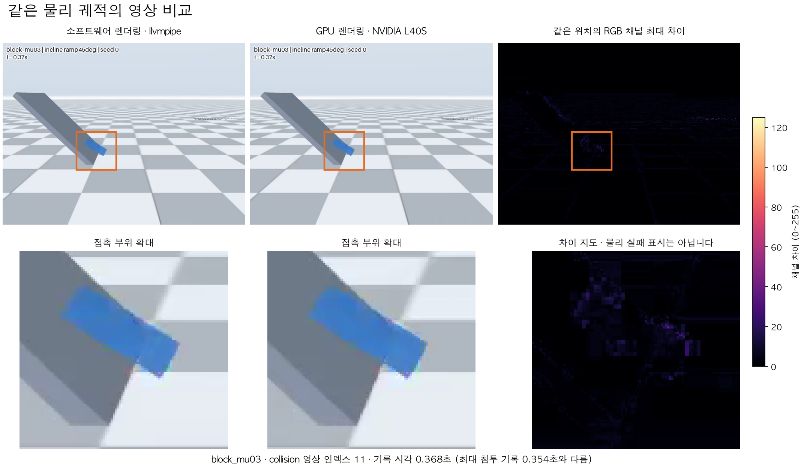
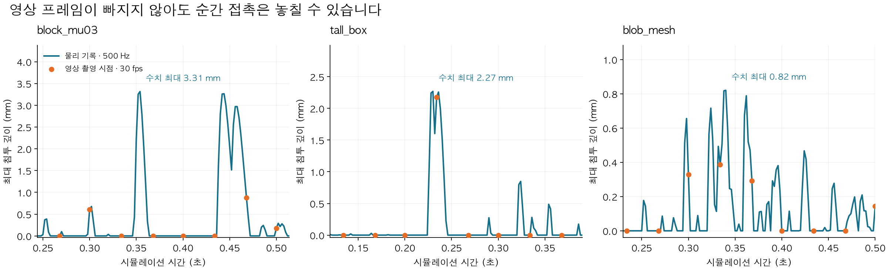

# CPU·GPU 환경이 달라도 같은 평가를 할 수 있을까요?

**각자 다른 컴퓨터로 실행할 수 있습니다. 다만 물리 계산 조건을 같게 맞추고, 영상과 수치의 역할을 구분해야 합니다.** 현재 하네스처럼 MuJoCo의 CPU 물리 계산을 유지하면서 영상만 소프트웨어 또는 GPU로 그리는 방식은 이번 샘플에서 수치 결과를 유지했습니다. GPU로 물리 계산 자체를 바꾸는 경우에는 별도의 비교가 필요합니다.

2026-11-18에 기존 Nebius 결과 전체와 Mac 실행 기록을 추가 대조했습니다. GPU를 새로 빌리지 않았습니다. 대표 이미지 비교를 **영상 54개, 27쌍, 3,084쌍의 전체 프레임 검사**로 넓혔습니다.

## 어떤 환경을 함께 사용할 수 있나요?

| 실행 방식 | 현재 확인한 내용 | 팀에서 사용할 기준 |
| --- | --- | --- |
| CPU 물리 + 소프트웨어 영상 | Linux의 llvmpipe 경로로 실행했습니다. | 물리 설정과 입력 파일이 같으면 사용할 수 있습니다. |
| CPU 물리 + NVIDIA GPU 영상 | 같은 Linux VM에서 수치·시계열이 소프트웨어 경로와 일치했습니다. | GPU 유무를 이유로 판정을 나눌 필요는 없습니다. 영상 조건은 고정합니다. |
| Mac CPU 물리 + Apple GPU 영상 | 로컬 렌더러는 실제로 `Apple M1`이었습니다. Linux와 빗면 샘플 3종을 대조했습니다. | 같은 버전과 조건을 사용하고, 대표 에셋으로 기기별 수치 차이를 확인합니다. |
| Windows 등 아직 비교하지 않은 환경 | 이번 실험에는 포함하지 않았습니다. | 공통 샘플을 먼저 돌려 호환성을 확인한 뒤 합칩니다. |
| MJX·MJWarp 등으로 물리도 GPU 실행 | 이번 Nebius 검증 대상이 아닙니다. | 기존 CPU 물리 결과와 별도 그룹으로 관리하고 교차 검증합니다. |

여기서 ‘로컬 CPU 실행’이라고 부르던 작업도 영상에는 내장 GPU를 사용하고 있었습니다. 중요한 구분은 **물리 엔진·버전·수치 정밀도**와 **영상 렌더러**입니다. 현재 저장 코드에서는 `mj_step`으로 물리를 진행하고 `data.time`에 맞춰 프레임을 찍습니다. 렌더링이 느리면 작업 완료가 늦어지지만, 벽시계 시간에 맞추려고 물리 step을 생략하지는 않습니다. [MuJoCo의 시각화 구조](https://mujoco.readthedocs.io/en/3.17.0/programming/visualization.html)

## 실제로 비교한 결과

| 확인 항목 | 결과 | 해석 |
| --- | --- | --- |
| 같은 Linux VM, 전체 검사 SW/GPU 9쌍 | 실행 상태·요약 수치가 같고 시계열 CSV의 SHA-256도 같습니다. | 이번 샘플의 물리 결과는 렌더러 변경에 영향받지 않았습니다. |
| Mac/Linux, 전체 검사 9쌍 | 실행 상태 9/9 일치. 요약 지표는 `tall_box`의 횡방향 이동 비율 끝자리 외에 일치합니다. | 해당 차이는 `0.000733664%`와 `0.000733665%`입니다. 파일 전체가 비트 단위로 같지는 않습니다. |
| 같은 초기 상태의 Mac/Linux 물리 궤적 | 위치 성분 최대 차이 `6.13×10⁻¹² m` 미만입니다. | 작은 빗면 샘플 3종에서의 관측값입니다. 모든 에셋·접촉 상황의 보증은 아닙니다. |
| 영상 54개 전체 디코딩 | 오류 없이 디코딩했고, 대응 영상의 해상도·fps·프레임 수·재생 시각이 같습니다. | E2는 각 240프레임, E3는 각 51~52프레임입니다. 예상 촬영 횟수도 일치합니다. |
| 영상 쌍별 전체 프레임 RGB RMSE | **1.65~2.14 / 255**입니다. | 픽셀 차이는 작지만 0은 아닙니다. |
| 영상 쌍별 평균 SSIM | **0.99598~0.99720**입니다. | 구조적 유사도이며, 평가 정확도나 사람·AI 판정 일치율은 아닙니다. |

물리 계산은 native MuJoCo 3.17.0입니다. 대상은 `block_mu03`, `tall_box`, `blob_mesh`이며 각 3회, seed 0으로 비교했습니다. Mac/Linux CSV는 6자리 유효숫자로 저장되어 있어, 그보다 작은 차이를 CSV만으로 정밀하게 판단하지 않습니다. 같은 초기 상태 궤적 비교는 별도 바이너리 상태를 사용했습니다.

## GPU를 쓰면 영상질도 좋아지나요?

**같은 해상도·카메라·조명·압축 설정이라면, GPU를 쓴다는 이유만으로 더 정확한 영상이 되지는 않습니다.** 이번에는 주로 생성 속도가 개선됐습니다. 하드웨어가 빨라지면 고해상도나 더 많은 시점을 저장할 여유가 생기지만, 그것은 출력 설정을 추가로 바꿨을 때의 효과입니다.

이번 영상은 모두 640×480, 30fps, H.264, yuv420p이며 원래 인코더 설정은 CRF 23입니다. 물체 윤곽·명암·바닥 무늬 주변에 렌더러와 인코딩을 합친 작은 픽셀 차이가 보입니다. 전체 평균이 국소 차이를 가리지 않도록 64×64 영역도 조사했으며, 가장 큰 영역 RMSE는 약 11.28이었습니다. 차이가 가장 큰 영역 중에는 배경 바닥 무늬도 있었습니다. 이것을 물체의 물리 실패로 해석하지 않습니다.

아래는 같은 프레임과 같은 좌표를 확대한 비교입니다. 작은 접촉 부위는 양쪽 모두 픽셀이 거칠어집니다. 이미 압축된 영상을 확대하는 것만으로 원래 없던 미세 형상 정보가 생기지는 않습니다.



영상으로 사람이 침투·틈·흔들림을 확인하거나, 나중에 영상 모델이 판정한다면 해상도, 카메라 각도, 조명, 색, 압축과 시간 표본이 영향을 줄 수 있습니다. 이번에는 사람의 블라인드 판정이나 영상 모델의 점수 일치 실험까지 수행하지 않았습니다. 현재 수치 기반 하네스에는 영상 모델이 물리 제어에 되먹임하는 경로가 없습니다. 그러한 정책을 추가한다면 렌더러 차이가 제어 입력과 궤적에도 영향을 줄 수 있으므로 별도로 검증해야 합니다.

## 더 중요한 발견: 30fps가 순간 침투를 놓칩니다

물리 기록 간격은 2ms, 영상 간격은 약 33.3ms입니다. 중간 계산이 정상적으로 저장되어도 영상에는 그중 일부 시점만 담깁니다. 기존 CSV와 촬영 코드의 시점을 대조하면 다음과 같습니다.

| 샘플 | 모든 수치 기록의 최대 침투 | 영상 촬영 시점에 해당하는 수치의 최댓값 | 최댓값이 작게 나타나는 비율 |
| --- | ---: | ---: | ---: |
| block_mu03 | **3.31493 mm** | **0.876803 mm** | 73.55% |
| tall_box | 2.26901 mm | 2.17540 mm | 4.13% |
| blob_mesh | 0.820246 mm | 0.460727 mm | 43.83% |

이 값은 영상 픽셀에서 깊이를 추정한 결과가 아닙니다. **CSV 중 영상이 촬영하는 시점의 행만 골랐을 때** 어떤 정보가 사라지는지 계산한 것입니다. CPU와 GPU 양쪽에서 같은 현상이 생깁니다. SW/GPU 차이보다 영상만으로 순간 실패를 판단하는 방식이 더 큰 문제가 될 수 있다는 근거입니다.



그래프는 각 샘플의 최고점 주변을 확대했습니다. 표의 최댓값은 전체 구간을 대상으로 합니다.

그래서 최종 수치 판정은 모든 물리 step의 시계열을 기준으로 하고, 영상은 형상과 상황을 이해하는 데 사용해야 합니다. 침투 최댓값·첫 충돌·전도 같은 주요 사건에서는 **그 시점의 상태를 따로 보존하고 무손실 확대 이미지**를 만드는 방식을 권합니다. 60fps로 늘리는 것만으로 짧은 사건이 모두 담기지는 않습니다.

## 환경 통일에서 우선할 것

| 항목 | 함께 맞출 내용 | 이유 |
| --- | --- | --- |
| 에셋 원본과 충돌 형상 | XML 및 참조 메시의 해시, 단위·스케일, 질량·관성, 충돌 분해 결과 | 같은 이름의 에셋이라도 형상이 다르면 다른 실험입니다. |
| 물리 설정 | MuJoCo 버전, 물리 backend·정밀도, timestep, integrator, solver·iterations·tolerance, 마찰·접촉 파라미터 | 접촉과 수렴 결과에 직접 영향을 줍니다. |
| 초기 조건 | 초기 자세·속도, 사전 안정화 방식, seed·교란, 종료 조건 | seed 하나만 같게 해서는 모든 초기 조건을 같게 만들 수 없습니다. |
| 영상 | 카메라 위치·시야각, 조명, visual/collision 구분, 해상도·fps·코덱·압축 설정 | 동일 상황을 동일하게 관찰해야 합니다. |
| 기록·판정 | 상태와 지표를 읽는 계산 단계, 프레임별 실제 시뮬레이션 시각, 지표 단위·판정 규칙 버전 | 시간이나 단위가 어긋나면 영상과 그래프의 비교가 부정확해집니다. |
| 실행 환경 | OS·CPU 아키텍처, GPU·드라이버·실제 렌더러 이름 | 차이가 발생했을 때 원인을 추적할 수 있습니다. |

특히 충돌 형상의 공유가 중요합니다. 기존 공통규약 댓글에는 **같은 CoACD 설정으로 머그를 분해했는데 Linux 27조각, Mac 25조각**이 나왔다는 팀원의 보고가 있습니다. 당시 통과 결과는 같았다는 보고이며, 이번에 해당 분해 실험을 재현한 것은 아닙니다. 그래도 분해를 각자 반복하기보다 **검증된 결과물을 한 번 만들어 해시와 함께 공유**할 이유가 됩니다. [공통규약 v3 댓글, 2026-11-18에 보존한 화면](https://app.notion.com/p/v3-41ab17b7a07b8121a63ec99fd40b86be)

운영 방식으로는 각자 로컬에서 개발·실험하고, **최종 제출 결과만 지정한 기준 환경에서 확인**하는 구성을 권합니다. 기준 환경은 고가 GPU일 필요가 없습니다. 동일한 CPU 물리 엔진과 입력·설정을 재현할 수 있으면 됩니다. 버전이 같아도 OS·아키텍처를 넘는 완전한 비트 일치는 MuJoCo가 보장하지 않으므로, 실제 에셋의 의미 있는 지표와 판정 경계에서 차이를 확인해야 합니다. [MuJoCo 재현성 조건](https://mujoco.readthedocs.io/en/3.17.0/computation/index.html#reproducibility)

## 다음 보완 순서

아래는 이번 조사에서 정리한 구현·운영 제안입니다. 팀 합의나 이미 적용된 공통규약으로 표시하지 않습니다.

1. **기준 입력 묶음과 비교 조건을 고정합니다.** 실제 에셋 중 평범한 물체, 얇은 벽·구멍, 복잡한 분해 형상, 판정 경계에 가까운 사례를 포함하고 같은 seed 목록으로 각 기기에서 실행합니다. 물리 설정·형상이 다른 결과는 먼저 분리합니다.
2. **기록 시점을 일관되게 맞춥니다.** 아래에서 확인한 한 step 차이를 하네스 담당자와 보완합니다. 현재 파일을 덮어쓰기보다 새 기록 형식·버전을 사용합니다.
3. **주요 사건의 상태와 확대 이미지를 저장합니다.** 전체 영상의 용량을 무조건 늘리는 대신, 최댓값 시점과 전후 상태를 보존하고 해당 시점의 PNG를 만듭니다. 프레임 번호와 실제 시뮬레이션 시각을 별도 표로 저장합니다.
4. **결과 화면에 환경 비교를 연결합니다.** 기본 화면은 간단하게 유지하면서, 두 결과를 비교할 때 입력·물리 설정이 다른 경우만 알려줍니다. 수치와 영상은 함께 보되 동일한 판정 근거로 취급하지 않습니다.
5. **GPU 물리와 영상 AI는 별도로 도입합니다.** MJX·MJWarp 결과를 native CPU 결과와 곧바로 합치지 않습니다. 예를 들어 MJWarp는 float32와 GPU 비결정성에 따른 차이를 공식적으로 설명합니다. [MJWarp의 수치·재현성 차이](https://mujoco.readthedocs.io/en/3.17.0/mjwarp/index.html#faq)

<details>
<summary>추가로 확인한 기록 시점과 초기 상태 문제</summary>

원래 하네스의 `StateSampler.sample()`은 현재 `data.time`·`qpos`와, 직전 계산 단계에서 갱신된 `xipos`·접촉 정보를 함께 읽습니다. `mj_step`은 마지막에 상태를 적분하므로 일부 파생 값이 이전 위치에 대응할 수 있습니다. [공식 데이터 일관성 설명](https://mujoco.readthedocs.io/en/3.17.0/computation/index.html#consistency-in-mjdata)

공유 코드는 수정하지 않고 Mac에서 `block_mu03`를 다시 실행했습니다. 실제 진행 데이터의 복사본에만 `mj_forward`를 적용해 비교했습니다. 사전 안정화 구간을 제외하고, 원래 기록의 침투 최고점은 시각 **0.354초**, 현재 상태에서 접촉을 다시 계산한 최고점은 **0.352초**였습니다. 최고 깊이 약 3.31493mm는 같았습니다. 같은 라벨 시각의 파생 위치 성분 차이는 관찰 구간에서 최대 약 **2.55mm**였습니다.

이는 CPU/GPU가 서로 다른 물리 결과를 냈다는 뜻이 아니라, **한 step인 2ms 동안의 움직임을 서로 다른 단계에서 읽는 문제**입니다. 앞의 침투 비교 그래프는 기존 파일의 기록 시각 그대로 표시합니다. 영상 촬영 시점 대조 역시 그 기록 체계를 기준으로 합니다. 이 차이는 영상 자체의 프레임 누락이나 최대 1.333ms의 30fps 촬영 시점 양자화와 별개입니다.

다음 기록기는 위치·자세·접촉·속도·라벨 시각을 같은 계산 단계에서 읽고, 실제 적분 경로를 바꾸지 않는지 검사해야 합니다. 단순히 매번 실제 진행 데이터에 `mj_forward`를 추가하면 warmstart 등에도 영향을 줄 수 있으므로 복사본에서의 갱신 또는 적절한 step 분할을 검토합니다.

또한 기존 E1 비교 래퍼는 `mjSTATE_FULLPHYSICS`를 저장합니다. 확인한 MuJoCo 3.17.0에서 이 비트 집합에는 `mjSTATE_WARMSTART`가 없습니다. 이번 Linux 3회 반복의 최종 qpos는 같았지만, 이를 완전한 적분 상태 복원으로 일반화하지 않습니다. 엄격한 후속 재현 시험에는 필요한 전체 integration state를 보존하고 매 반복의 시작을 동일하게 해야 합니다. 기존 실험 파일은 유지합니다.

</details>

<details>
<summary>검사 방법·결과 파일·재현 명령</summary>

- 영상 검사는 크기·색공간·프레임률·모든 PTS·프레임 수가 일치하는지 먼저 확인합니다. 불일치를 리사이즈·시간 이동·프레임 복제로 숨기지 않습니다.
- E2의 상태·모델 파일 해시를 다시 계산하고, E3의 원본 시계열 해시와 수치 일치를 확인한 뒤 영상을 비교했습니다.
- RGB RMSE는 압축 영상을 같은 FFmpeg로 디코딩한 픽셀 차이입니다. SSIM은 FFmpeg의 필터로 모든 대응 프레임을 비교했습니다. 원본 촬영의 절대 화질, 사람 판정, AI 판정을 검증한 점수는 아닙니다. [FFmpeg SSIM 설명](https://ffmpeg.org/ffmpeg-filters.html#ssim)
- 모든 프레임의 원시 수치와 최악의 국소 차이 프레임은 개인 결과 폴더 `Nebius_GPU_검증/전체프레임_품질점검/`에 보존했습니다.
- 저장소에는 [비교 수치 JSON](assets/nebius-20261118/render-quality-audit.json)과 두 그림을 보존합니다. 추가한 검사와 기존 벤치마크 검사는 합계 **27개 통과**했습니다.
- [기존 GPU 실행·비용 보고서](Nebius_GPU_검증.md)에는 성능·클라우드 자원 정리 결과가 있습니다.

작업 폴더 `implementation/review`에서 다음과 같이 실행합니다. 출력은 존재하지 않는 새 경로로 지정합니다.

```bash
.venv/bin/python scripts/audit_render_quality.py /path/to/results-fixed-initial \
  --output /path/to/new-frame-audit

.venv/bin/python scripts/audit_capture_sampling.py /path/to/results-fixed-initial \
  --source /path/to/incline_env \
  --output /path/to/new-frame-audit/capture-sampling.json

.venv/bin/python -m pytest tests/test_render_quality.py \
  tests/test_capture_sampling.py tests/test_benchmarks.py -q
```

</details>
